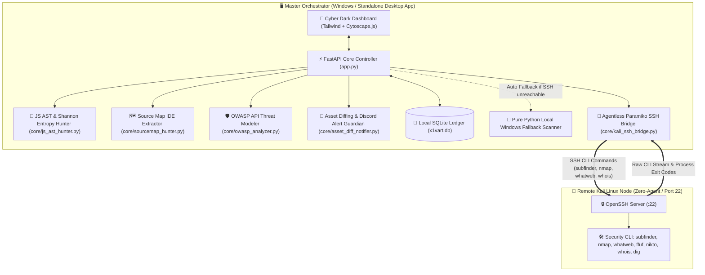

# 🛡️ x1vart — Attack Surface & API Security Audit Platform
### *Enterprise External Attack Surface Management (EASM) & OWASP API Top 10 Audit Suite*

<p align="center">
  
  
  
  
  
  
</p>

---

## 📑 Table of Contents
1. [Overview](#-1-overview)
2. [System Architecture](#-2-system-architecture)
3. [Key Innovations](#-3-key-innovations)
4. [6-Stage Reconnaissance Pipeline](#-4-6-stage-reconnaissance-pipeline)
5. [Quick Start Deployment](#-5-quick-start-deployment)
6. [Kali Linux Agentless SSH Setup](#-6-kali-linux-agentless-ssh-setup)
7. [10 Specialized Audit Modules](#-7-10-specialized-audit-modules)
8. [REST API Documentation](#-8-rest-api-documentation)
9. [Project Directory Layout](#-9-project-directory-layout)
10. [Legal & Ethical Disclaimer](#-10-legal--ethical-disclaimer)

---

## 🌟 1. Overview

**x1vart Platform** is an enterprise-grade, open-source security solution specializing in **External Attack Surface Management (EASM)**, **Active API Vulnerability Auditing**, and **Web Reverse Engineering (JS AST & Source Map Decompilation)**.

Engineered with modern cybersecurity standards, it delivers an integrated experience for Red Teams, Blue Teams, and DevSecOps practitioners:
- 🚀 **Native Desktop App Window**: Launches seamlessly as a standalone, distraction-free desktop application (Chromium Native App mode), zero lag, and zero address bar clutter.
- 🔗 **Agentless SSH Bridge**: Controls remote Kali Linux environments directly over standard SSH (Port 22). No agents, custom daemons, or background workers needed on the Kali instance.
- 🛡️ **OWASP API Top 10:2023 Threat Modeler**: Automated risk exposure analysis, dynamic Risk Scoring, and multi-dimensional 10-axis Cyber Threat Radar visualization.
- 💎 **Deep JS AST & Shannon Entropy Secrets**: Parses Webpack and Vite client bundles, isolates hidden endpoints, identifies BOLA/IDOR parameters, and recovers high-entropy secrets ($H(X) \ge 3.0$).
- 📦 **Source Map (.js.map) Reconstructor**: Reconstructs 100% of original client source files (TypeScript, React JSX, Vue) with a built-in 2-column Mini IDE.
- 🌐 **Multi-Tiered Network Whois & ASN Resolver**: Hybrid lookup combining native Kali Linux Whois CLI, official RDAP registries (ARIN/APNIC with HTTP redirect tracking), and IP Geolocation.

---

## 🏛️ 2. System Architecture

The platform operates via a high-performance orchestration model pairing a **Central Orchestrator** on Windows with a **Zero-Deploy Security Execution Node** on Kali Linux:



---

## ⚡ 3. Key Innovations

| Capability | Technical Implementation |
|:---|:---|
| **🕸️ Cytoscape Topology Graph** | Interactive hierarchical attack surface tree (`Target` $\rightarrow$ `Subdomain` $\rightarrow$ `JS Bundle` $\rightarrow$ `Secrets/APIs`). Features dynamic **Kill-Chain Path Simulation** with glowing particle propagation. |
| **🛡️ Cyber Threat Radar** | HTML5 Canvas 10-axis radar chart mapping real-time exposure severity against baseline benchmarks for **OWASP API Security Top 10:2023**. |
| **🗺️ Source Map Mini IDE** | In-browser reverse engineering workstation: Collapsible file tree on the left, line-numbered syntax viewer on the right with automated vulnerability and credential flags. |
| **🔑 Shannon Entropy Secrets Hunter** | Applies statistical information theory to quantify string randomness: $$H(X) = -\sum_{i=1}^{n} P(x_i) \log_2 P(x_i)$$ Flags API keys, JWTs, AWS credentials, and private certificates ($H(X) \ge 3.0$). |
| **📟 Dual-Node Terminal HUD** | Real-time dual stream displaying orchestrated background dispatch events alongside live remote Kali Linux CLI command executions. |
| **🔔 Continuous EASM & Discord Guardian** | Automated scan scheduling (6h, 12h, 24h, 7d intervals). Tracks infrastructure drift via SQLite delta diffing and pushes instant webhook alerts on new attack surfaces. |

---

## 🔄 4. 6-Stage Reconnaissance Pipeline

```text
[Stage 1: OSINT & Subdomain Discovery]
 ├── Kali CLI: subfinder -d <target> -silent
 ├── Passive CT Logs (crt.sh) + Reverse DNS + Dig
 ├── Wildcard DNS Filtering & Smart Permutation Engine
 └── Dangling CNAME Analysis (Subdomain Takeover Detection)
       │
[Stage 2: Port & Service Fingerprinting]
 ├── Kali CLI: nmap -F -sV --version-light -T4 <host>
 └── Fallback: Asynchronous Multi-threaded TCP Port Scanner
       │
[Stage 3: Technology Stack & Server Audit]
 ├── Kali CLI: whatweb -a 1 <target>
 ├── Kali CLI: nikto -h <target> -Tuning 123b
 └── SSL/TLS Certificate Expiration & HTTP Security Headers (HSTS, CSP)
       │
[Stage 4: Directory Fuzzing & CORS Verification]
 ├── Embedded Mini-wordlist (40+ sensitive files: .env, .git, backup.zip)
 ├── Directory Fuzzing (ffuf / Async HTTP Client)
 └── CORS Misconfiguration Audit (Arbitrary Origin Reflection Test)
       │
[Stage 5: Deep JS AST & Shannon Entropy Hunter]
 ├── AST Parsing of client Webpack / Vite bundles
 ├── Hidden API Endpoints & BOLA/IDOR Parameter Extraction ({userId}, {orderId})
 └── Shannon Entropy Threshold Filter: H(X) >= 3.0 (Tokens, Keys, Hashes)
       │
[Stage 6: Source Map Reconstruction & Reporting]
 ├── Fetch and unpack exposed production Source Maps (.js.map)
 ├── Full reconstruction of original project tree into Mini IDE
 ├── OWASP API Top 10 Threat Modeling & Executive Report Generation
 └── OpenAPI 3.0 Specification Export (Swagger / Postman compliant)
```

---

## 🚀 5. Quick Start Deployment

### Method 1: 1-Click Portable Executable (Recommended for End Users)
1. Download the standalone executable **`x1vart.exe`** from the **[Releases](../../releases)** page.
2. Double-click **`x1vart.exe`** to launch.
3. The platform boots its embedded server and opens the native desktop application window automatically. No Python installation or dependencies required.

---

### Method 2: Single-Command Docker Deployment
```bash
# Launch the entire environment
docker compose up -d

# Open your browser at:
http://localhost:8000
```

---

### Method 3: Run from Source (For Developers)
```bash
# 1. Clone repository
git clone https://github.com/your-username/x1vart-web-recon.git
cd x1vart-web-recon

# 2. Install dependencies
pip install -r requirements.txt

# 3. Start the application
python app.py
```
> On Windows, double-click `run.bat` to automatically initialize the virtual environment, install requirements, and start the app.

---

## 🐧 6. Kali Linux Agentless SSH Setup

The platform is strictly **Agentless** — zero installation required on your Kali Linux instance.

### Step 1: Start SSH on Kali Linux
Open terminal on your Kali Linux machine or virtual machine and run:
```bash
sudo systemctl start ssh
```

*(Recommended)* Ensure standard security CLI tools are installed:
```bash
sudo apt update && sudo apt install -y nmap whatweb nikto ffuf gobuster dnsutils whois subfinder
```

### Step 2: Connect from x1vart Dashboard
1. Click **`[SSH Config]`** on the top navigation bar.
2. Enter your Kali connection details (Default: User `kali`, Password `kali`, Port `22`).
3. Click **`[Save Settings]`**, then click **`[Test SSH]`**:
   - Once connected, the badge updates to **ONLINE**, and all available CLI tool pills illuminate green.
   - If Kali is unreachable or powered down, the system gracefully falls back to **LOCAL WINDOWS MODE** without interrupting your workflow.

---

## 📊 7. 10 Specialized Audit Modules

```text
├── 1. Overview & Infrastructure Map -> Tech Stack, Subdomain Takeover, HTTP Headers, Reverse IP
├── 2. API Surface & BOLA Extraction -> Hidden Endpoints, BOLA/IDOR Parameters, Live API Tester Console
├── 3. Source Code & Secrets Hunter  -> Shannon Entropy Filter H(X)>=3.0, Leakage Context & Line Locator
├── 4. Source Map Mini IDE           -> Reverse engineered .js.map files, 2-column code explorer
├── 5. Vulnerabilities & Ports       -> CORS Misconfiguration, Exposed Files (.env, .git), Nmap, Nikto
├── 6. Public OSINT & Network Whois  -> Multi-tier Whois & ASN Explorer (Kali CLI + RDAP), Document Metadata
├── 7. OWASP API Top 10 Modeler      -> Cyber Threat Radar, 10-risk exposure matrix, remediation guides
├── 8. Dual-Node Terminal HUD        -> Live synchronization of Windows dispatch events and Kali CLI executions
├── 9. Scan History & Delta Diff     -> SQLite audit trail, instant reload, Delta Diff comparison engine
└── 10. Continuous EASM & Alerts     -> Automated cron intervals, Discord Webhook Guardian notifications
```

---

## 🔌 8. REST API Documentation

| Method | Endpoint | Description |
|:---:|:---|:---|
| `POST` | `/api/recon/start` | Initiates asynchronous reconnaissance job in the background; returns `scan_id` |
| `GET` | `/api/recon/status/{scan_id}` | Real-time progress monitoring (% completed, current stage, logs) |
| `POST` | `/api/whois/lookup` | On-demand Whois & ASN lookup (Kali CLI + RDAP fallback) |
| `POST` | `/api/api-tester/send` | Dispatches live HTTP requests and returns response telemetry |
| `GET` | `/api/report/export` | Generates comprehensive Executive Security Audit Report in HTML / PDF |
| `GET` | `/api/openapi/download` | Exports auto-generated OpenAPI 3.0 JSON specification |
| `POST` | `/api/ssh/test` | Verifies remote Kali Linux SSH reachability and tool availability |
| `POST` | `/api/easm/schedules` | Registers continuous attack surface monitoring schedules |
| `POST` | `/api/easm/discord/test`| Sends test security alert notification to configured Discord Webhook |

---

## 📁 9. Project Directory Layout

```text
x1vart-web-recon/
├── app.py                      # Central Master Controller & Desktop Application Runner
├── build_exe.py                # Standalone PyInstaller One-file Packaging Script
├── requirements.txt            # Python dependencies manifest
├── run.bat                     # Windows automated launcher script
├── Dockerfile                  # Standalone container specification
├── docker-compose.yml          # One-command Docker stack configuration
├── x1vart.db                   # Embedded SQLite Database (Scan Ledger & Schedules)
├── test_check.py               # Framework-free verification suite (Pure assert-based)
├── core/
│   ├── kali_ssh_bridge.py      # Agentless SSH Bridge orchestrator via paramiko
│   ├── db_manager.py           # SQLite database persistence & EASM scheduler ledger
│   ├── js_ast_hunter.py        # JS AST parsing, API discovery & Shannon Entropy calculator
│   ├── sourcemap_hunter.py     # Source Map unpacker & original code tree reconstructor
│   ├── owasp_analyzer.py       # OWASP API Security Top 10:2023 threat modeling engine
│   ├── openapi_bridge.py       # Dynamic OpenAPI 3.0 specification generator
│   ├── report_generator.py     # Executive Security Audit Report generator (HTML/PDF)
│   └── asset_diff_notifier.py  # Attack surface delta diff engine & Discord Webhook Guardian
└── static/
    └── index.html              # Cyber Dark Dashboard, Cytoscape Graph & Mini IDE UI
```

---

## ⚖️ 10. Legal & Ethical Disclaimer

> **Notice**:
> The **x1vart** platform is developed strictly for educational purposes, academic security research, and authorized defensive auditing. The authors and contributors assume no liability for misuse, unauthorized testing, or damage resulting from the use of this software. Users are solely responsible for ensuring compliance with all applicable local, national, and international cybersecurity laws before scanning target systems.

---

<p align="center">
  Maintained by <b>x1vart Security Research Team</b> • Distributed under the <b>MIT License</b>
</p>
